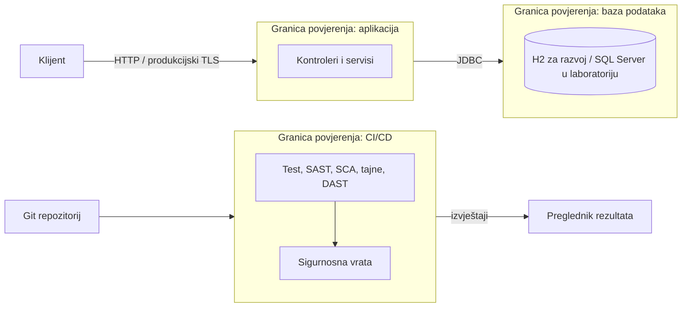

# Model prijetnji (STRIDE) – MedTermin – naručivanje pregleda, varijanta V01

## Stanje modela

Tablice i DFD opisuju izvornu lokalnu aplikaciju. Nakon popravaka treba uzeti u obzir BCrypt, nasumične jednokratne reset tokene, autorizaciju nalaza i ograničeni CORS; te mjere ne uklanjaju sve rizike. U lokalnom ZAP pregledu ostala su upozorenja o anti-CSRF tokenima i CSP `style-src unsafe-inline`, koja zahtijevaju dodatnu procjenu.


> Tablice niže opisuju **izvorno stanje prije popravaka** i povijesnu procjenu, ne aktualno ponašanje. Ažurirane mjere i otvoreni rizici nalaze se u [pregledu provjera](../alati/poslije/README.md). Navedene ocjene nisu CVSS, a dinamička iskoristivost svih scenarija nije potvrđena.

Model prijetnji izrađen je prema metodologiji STRIDE kako bi se sustavno identificirale potencijalne prijetnje, procijenili rizici i odredile zaštitne mjere za web aplikaciju poliklinike MedTermin (varijanta V01). Na kraju analize model je dopunjen stvarno utvrđenim nalazima iz pregleda koda i sigurnosnih skeniranja.

---

## 1. Opis sustava

Aplikacija **MedTermin** je web platforma privatne poliklinike namijenjena pacijentima i medicinskom osoblju. Pacijentima omogućuje pregled dostupnih liječnika i slobodnih termina, naručivanje na preglede, otkazivanje vlastitih rezervacija, pregled i preuzimanje medicinskih nalaza te ispis potvrde rezervacije. Liječnicima i administratorima omogućuje uvoz rasporeda termina iz XML datoteka, dok administrator ima puni uvid u sve zapise sustava.

### Akteri

1. **Anonimni posjetitelj (neprijavljeni korisnik):**
   - Može pristupiti početnoj stranici (`/`), obrascu za prijavu (`/prijava`), statusu sustava (`/api/health`), registraciji novog korisničkog računa (`POST /api/auth/register`) te zatražiti obnovu lozinke (`POST /api/auth/reset-zahtjev`) i postaviti novu lozinku pomoću tokena (`POST /api/auth/reset`, `/reset`).
2. **Prijavljeni pacijent (uloga `KORISNIK` – npr. `ana`, `marko`):**
   - Pregledava popis liječnika i slobodnih termina.
   - Kreira, pregledava i otkazuje vlastite rezervacije pregleda.
   - Pregledava i preuzima isključivo vlastite medicinske nalaze (JSON, PDF, TXT).
   - Generira HTML potvrdu vlastite rezervacije za ispis.
   - Pregledava i uređuje vlastite postavke obavijesti u YAML formatu.
3. **Liječnik (uloga `LIJECNIK` – npr. `dr.horvat`):**
   - Posjeduje sve ovlasti pacijenta.
   - Može uvoziti nove rasporede termina iz strukturiranih XML datoteka (`POST /api/termini/uvoz`).
4. **Administrator (uloga `ADMIN` – npr. `admin`):**
   - Posjeduje sve ovlasti pacijenta i liječnika.
   - Ima administratorski uvid u sve rezervacije i medicinske nalaze u sustavu.
5. **Vanjski bolnički informacijski sustav (BIS):**
   - Mock servis (`BolnickiSustavKlijent`) koji simulira integraciju s centralnim bolničkim sustavom i generira oznaku rezervacije (npr. `BIS-1-1000`).

### Komponente

- **Klijentski sloj (Preglednik / HTTP klijent):** Web preglednik, alati poput REST klijenta (IntelliJ / VS Code), cURL ili automatizirani skeneri (OWASP ZAP, Burp Suite).
- **Web i sigurnosni filtri (Spring Boot Web / Jakarta Servlet):**
  - `CorsFilter`: Obrada zahtjeva među različitim domenama (CORS).
  - `AuthFilter`: Provjera valjanosti sesijskog kolačića `SESSION` ili zaglavlja `Authorization: Bearer <token>`.
  - `TokenStore`: Pohrana aktivnih sesijskih tokena u radnoj memoriji poslužitelja.
- **Aplikacijski kontroleri i servisi:**
  - `AuthController` i `KorisnikService`: Autentikacija, registracija, provjera lozinki i profila.
  - `PrijavaController`: Posluživanje HTML stranica za prijavu, početne stranice i postavljanje kolačića.
  - `ResetLozinkeService`: Generiranje tokena za zaboravljenu lozinku i postavljanje nove lozinke.
  - `LijecnikController`: Pretraživanje i sortiranje liječnika.
  - `TerminController` i `UvozTermina`: Prikaz slobodnih termina i XML parsiranje uvoza.
  - `RezervacijaController` i `RezervacijaService`: Poslovna logika rezervacija i otkazivanja.
  - `IspisController`: HTML renderiranje potvrde rezervacije za ispis.
  - `NalazController`: Prikaz i preuzimanje laboratorijskih i radioloških nalaza.
  - `PostavkeController`: Obrada korisničkih konfiguracija obavijesti u YAML formatu.
- **Baza podataka (H2 in-memory):** Relacijska baza podataka u radnoj memoriji (`jdbc:h2:mem:medtermin`).
- **Lokalni datotečni sustav:**
  - `./data/dokumenti`: Pohrana medicinskih nalaza u tekstualnom obliku.
  - `./data/posta`: Pohrana generiranih simuliranih poruka e-pošte za reset lozinke.
- **Aplikacijski logovi (SLF4J / Logback):** Zapisivanje operacija sustava na standardni izlaz poslužitelja.

### Tokovi podataka i granice povjerenja (Data Flow Diagram - DFD)

```
       [ Anonimni korisnik / Pacijent / Liječnik / Administrator ]
                                   │
                                   │ HTTP / HTTPS (Zahtjevi, Zaglavlja, Kolačići)
═══════════════════════════════════╪═════════════════════════════════════════════
   GRANICA POVJERENJA 1: Internet / Mreža klijenta ──► Web poslužitelj
═══════════════════════════════════╪═════════════════════════════════════════════
                                   ▼
                       [ CorsFilter & AuthFilter ]
                                   │
                                   ▼
                   [ Spring Boot REST & Web Kontroleri ]
                                   │
          ┌────────────────────────┼────────────────────────┐
          │                        │                        │
          ▼                        ▼                        ▼
 [ KorisnikService /      [ TerminController /     [ NalazController /
   ResetLozinkeService ]    RezervacijaService ]     PostavkeController ]
          │                        │                        │
══════════╪════════════════════════╪════════════════════════╪════════════════════
   GRANICA POVJERENJA 2: Aplikacijski sloj ──► Baza podataka / Datotečni sustav
══════════╪════════════════════════╪════════════════════════╪════════════════════
          ├────────────────────────┴────────────────────────┤
          ▼                                                 ▼
[ H2 Relacijska Baza Podataka ]                 [ Lokalni Datotečni Sustav ]
 (korisnici, termini, nalaz,                     (data/dokumenti - nalazi,
  rezervacije, postavke, reset)                   data/posta - e-mail poruke)
          │                                                 │
          ▼                                                 ▼
[ Aplikacijski Događaji / Log ]                 [ Vanjski BIS Servis ]
 (Konzola poslužitelja / SLF4J)                  (BolnickiSustavKlijent mock)
```

Granice povjerenja:
1. **Granica 1 (Klijent – Poslužitelj):** Sav ulaz koji dolazi od korisnika (JSON tijela, URL parametri, zaglavlja, kolačići) smatra se nepouzdanim i mora proći provjeru formata, autentikaciju i autorizaciju.
2. **Granica 2 (Aplikacija – Baza podataka):** Podaci koji se šalju u SQL bazu moraju biti parametrizirani kako bi se spriječila SQL injekcija.
3. **Granica 3 (Aplikacija – Datotečni sustav):** Korisnički zadani nazivi datoteka ne smiju omogućiti izlazak iz predviđene mape (Path Traversal).
4. **Granica 4 (Aplikacija – Vanjski sustavi i zapisi):** Podaci koji se prosljeđuju u zapise (logove) moraju biti oslobođeni tajni (lozinki) i osobnih podataka (OIB).

---

### Granica CI/CD sustava



CI izvršava kod iz repozitorija, stoga su prava runnera, ulazne grane, tajne i artefakti zasebna granica povjerenja. Lokalni H2 i laboratorijski SQL Server nisu ista produkcijska konfiguracija.

| Element CI/CD | S | T | R | I | D | E |
|---|---|---|---|---|---|---|
| Repozitorij i workflow | lažni doprinositelj | izmjena pravila vrata | nedostatak revizije commita | izlaganje tajne | preopterećenje poslova | izmjena privilegija workflowa |
| Runner i artefakti | lažni runner | podmetanje izvještaja | nedostaju zapisi izvođenja | curenje logova | nedostupan alat | zloporaba tokena posla |

### Registar preostalog rizika

Procjene su radne (1–3); preostali rizik nije rezultat produkcijskog mjerenja.

| Prijetnja | Imovina | V × U | Postupanje i mjera s dokazom | Preostali rizik |
|---|---|---|---|---|
| Pristup tuđem nalazu | zdravstveni podaci | 3 × 3 | Umanjiti: provjera vlasništva; `SigurnostHttpTest` | Srednji: potrebna revizija svih endpointa |
| Prolazak kroz putanju | datoteke nalaza | 3 × 3 | Umanjiti: ograničena putanja i NOFOLLOW; `PutanjeSigurnosniTest` | Srednji: ovisi o datotečnom sustavu |
| Krađa računa preko reseta | korisnički računi | 3 × 3 | Umanjiti: slučajan jednokratni token; `AutentikacijaSigurnostTest` | Srednji: stvarna dostava pošte nije dokazana |
| Pogađanje lozinki | računi i dostupnost | 3 × 3 | Umanjiti: BCrypt i lokalni limit; `OgranicenjeAutentikacijeTest` | Srednji: limit je lokalni i IP može biti dijeljena |
| Ranjiva ovisnost | aplikacija i podaci | 2 × 3 | Umanjiti: SBOM i OSV; `ci/sca.sh` i `ci/gate.py` | Srednji: ovisi o ažurnosti baze nalaza i uspješnom CI-u |

---

## 2. Imovina

| Imovina | Zašto je vrijedna | Tko joj smije pristupiti |
|---|---|---|
| **Lozinke korisnika (sažeci)** | Kompromitacija omogućuje preuzimanje korisničkih računa pacijenata, liječnika i administratora. | Samo autentikacijski mehanizam poslužitelja pri provjeri (nitko u čistom tekstu). |
| **Sesijski i autentikacijski tokeni** | Omogućuju autorizirani pristup API-ju u ime prijavljenog korisnika. | Isključivo klijent kojemu je token izdan i radna memorija poslužitelja (`TokenStore`). |
| **Tokeni za poništavanje lozinke** | Omogućuju promjenu lozinke i preuzimanje korisničkog računa. | Isključivo vlasnik računa putem poslane e-pošte i servis za reset lozinke. |
| **Medicinski nalazi i zdravstveni podaci** | Iznimno osjetljivi osobni podaci posebne kategorije (GDPR); curenje narušava privatnost i stvara pravnu odgovornost. | Isključivo pacijent na kojeg se nalaz odnosi te ovlašteni liječnici i administrator. |
| **Osobni podaci pacijenata (OIB, ime, e-mail)** | Zaštićeni identifikacijski podaci pacijenata. | Pacijent na kojeg se odnose, ovlašteni liječnik i administrator. |
| **Raspored i rezervacije termina** | Poslovni podaci o radu poliklinike i zauzetosti ordinacija; sprječavanje preklapanja i neovlaštenih izmjena. | Svi prijavljeni korisnici mogu vidjeti slobodne termine; vlastite rezervacije samo pacijent, liječnik i admin. |
| **Integritet aplikacijskih zapisa (logova)** | Ključni za sigurnosni nadzor, forenziku i otkrivanje incidenata. | Isključivo administratori sustava i sigurnosno osoblje. |
| **Dostupnost sustava poliklinike** | Prekid rada onemogućuje pacijentima naručivanje i pristup nalazima. | Svi legitimni korisnici sustava. |

---

## 3. Prijetnje po STRIDE kategorijama

Legenda kategorija STRIDE:
- **S** – *Spoofing* (Lažno predstavljanje)
- **T** – *Tampering* (Neovlaštena izmjena podataka)
- **R** – *Repudiation* (Poricanje odgovornosti)
- **I** – *Information Disclosure* (Otkrivanje informacija / curenje podataka)
- **D** – *Denial of Service* (Uskraćivanje usluge)
- **E** – *Elevation of Privilege* (Podizanje ovlasti)

| Element (endpoint / komponenta) | S – lažno predstavljanje | T – neovlaštena izmjena | R – poricanje | I – otkrivanje informacija | D – uskraćivanje usluge | E – podizanje ovlasti |
|---|---|---|---|---|---|---|
| `GET /api/health` | – | – | – | Otkrivanje statusa aplikacije i tehnološkog stoga | Iscrpljivanje resursa poplavom zahtjeva | – |
| `POST /api/auth/login` | Brute-force pogađanje lozinki; credential stuffing | Izmjena tijela zahtjeva u tranzitu ako nema TLS-a | Nedostatak bilježenja neuspjelih prijava | **Curenje lozinke u log poslužitelja (N-06)** | Zaključavanje računa ili preopterećenje poslužitelja | Neovlaštena prijava na tuđi račun |
| `POST /api/auth/register` | Registracija s tuđim podacima ili e-mailom | Injekcija zlonamjernih znakova u korisničko ime | – | Otkrivanje zauzetih korisničkih imena (user enumeration) | Masovno kreiranje lažnih računa | Pokušaj dodjele povlaštene uloge kroz unos (npr. uloga=ADMIN) |
| `GET /api/ja` | Korištenje ukradenog ili krivotvorenog sesijskog tokena | – | – | Curenje profila korisnika i OIB-a trećim stranama | – | Pristup podacima drugog korisnika s neopozvanim tokenom |
| `POST /api/auth/reset-zahtjev` | Zahtjev za reset tuđe lozinke radi ometanja | – | – | **Deterministički izračun predvidljivog tokena bez čitanja maila (N-03)** | Preopterećenje stvaranjem datoteka u `data/posta/` | **Potpuno preuzimanje administratorskog računa (N-03)** |
| `POST /api/auth/reset` | **Iskorištavanje predvidljivog MD5 tokena (N-03)** | **Ponovna uporaba već iskorištenog tokena (N-04)** | Nepostojanje trajnog audit zapisa o izmjeni lozinke | – | – | **Preuzimanje računa i trajna promjena lozinke (N-03, N-04)** |
| `GET /api/lijecnici` | – | **Manipulacija SQL upitom kroz parametre `sort` i `smjer` (N-09)** | – | **Izvlačenje podataka iz baze putem SQL injekcije (N-09)** | Rušenje baze ili prekid rada složenim SQL funkcijama | Izvršavanje nedozvoljenih funkcija baze podataka |
| `GET /api/termini` | – | – | – | Uvid u popunjenost i termine poliklinike | – | – |
| `POST /api/termini/uvoz` | Slanje XML-a bez uloge liječnika ili admina | Ubacivanje malicioznih termina u raspored | Poricanje unosa pogrešnog rasporeda | XXE napad (čitanje lokalnih datoteka preko entiteta) | XML Denial of Service (Billion Laughs napad) | Neovlašteni uvoz termina od strane običnog pacijenta |
| `POST /api/rezervacije` | Rezervacija u ime drugog pacijenta s tuđim OIB-om | Dvostruka rezervacija istog mjesta (race condition) | Poricanje rezervacije termina | **Otkrivanje OIB-a i zdravstvene napomene u logovima (M12)** | Iscrpljivanje svih slobodnih termina poliklinike | – |
| `GET /api/rezervacije/moje` | Krađa sesijskog tokena pacijenta | – | – | Prikaz termina i povijesti narudžbi pacijenta | – | – |
| `DELETE /api/rezervacije/{id}` | Lažiranje identifikatora rezervacije | Otkazivanje tuđe rezervacije promjenom ID-a | Poricanje otkazivanja pregleda | – | Uskraćivanje termina legitimnom pacijentu | Otkazivanje termina drugih pacijenata (IDOR) |
| `GET /ispis/rezervacije/{id}` | Pristup ispisu tuđe rezervacije bez ovlasti | Cross-Site Scripting (XSS) kroz polje napomene | – | Neovlašteni uvid u potvrdu pregleda drugog pacijenta | – | Zaobilaženje autorizacije nad ispisom |
| `GET /api/nalazi/moji` | Pristup tuđem popisu nalaza | – | – | Curenje popisa medicinskih pretraga | – | – |
| `GET /api/nalazi/{id}` | Pristup tuđem nalazu navođenjem tuđeg ID-a | – | – | **Zaobilaženje autorizacije nevaljanim formatom i curenje tuđeg nalaza (N-01)** | – | **BOLA/IDOR pristup povjerljivim medicinskim podacima (N-01)** |
| `GET /api/nalazi/preuzmi` | Preuzimanje tuđih datoteka nalaza | – | – | **Path traversal i čitanje tuđih nalaza i datoteka sustava (N-02)** | – | **Neovlašteni pristup datotečnom sustavu (N-02)** |
| `GET /api/postavke` | Krađa sesije i uvid u postavke obavijesti | – | – | Otkrivanje komunikacijskog kanala pacijenta | – | – |
| `POST /api/postavke` | Slanje malicioznog YAML sadržaja | **RCE / deserijalizacija zlonamjernih Java klasa (SnakeYAML CVE-2022-1471)** | – | Otkrivanje internog stanja memorije poslužitelja | DoS napad kroz YAML parsiranje | **Izvršavanje proizvoljnog programskog koda na poslužitelju (RCE)** |
| `GET /prijava` | Phishing napad manipulacijom parametra `returnUrl` | – | – | Otkrivanje parametara klijenta | – | – |
| `POST /prijava` | Krađa vjerodajnica kroz lažno preusmjeravanje | **Presretanje kolačića bez `Secure` zastavice na mreži (M10)** | Nedostatak logiranja neuspjele prijave | **Otvoreno preusmjeravanje na zlonamjerni web poslužitelj (N-08)** | Brute force napad na web formu | Preuzimanje sesije presretanjem nezaštićenog kolačića |
| `GET /reset` | Zlouporaba obrasca za provjeru valjanosti tokena | – | – | – | – | – |
| `POST /reset` | Pogađanje tokena za reset lozinke | **Korištenje isteka ili više puta istog tokena (N-04)** | – | – | – | **Neovlaštena promjena lozinke žrtve (N-03, N-04)** |
| `CorsFilter` | **Zlonamjerni web šalje zahtjeve u ime žrtve (N-07)** | Neovlašteno okidanje akcija putem zlonamjernog JS-a | – | **Čitanje odgovora API-ja s tuđe domene uz vjerne podatke (N-07)** | – | Zaobilaženje Same-Origin politike preglednika |
| `LozinkaHasher` | – | Izmjena sažetka u bazi podataka | – | **Izvanmrežno probijanje lozinki rainbow tablicama (SHA-256 bez soli) (N-05)** | – | Masovno preuzimanje računa nakon krađe baze |
| `TokenStore` | Korištenje sesije nakon odjave | – | – | – | Memorijsko iscrpljivanje nekontroliranim brojem tokena | **Trajna valjanost ukradenog tokena bez mogućnosti opoziva (M09)** |

---

## 4. Procjena rizika i mjere

| # | Prijetnja | Vjerojatnost (1–3) | Utjecaj (1–3) | Rizik (V×U) | Postojeća zaštita | Potrebna mjera | Nalaz |
|---|---|---|---|---|---|---|---|
| **P-01** | BOLA zaobilaženje autorizacije pri dohvatu nalaza s nevaljanim formatom | 3 | 3 | **9 (Kritičan)** | Provjera vlasništva postoji, ali se nalazi iza `Format.valueOf` u `try` bloku. | Provjeriti vlasništvo nad nalazom prije parsiranja formata i bilo kakvog grananja koda. | **N-01** |
| **P-02** | Path traversal i neovlašteno preuzimanje datoteka nalaza pomoću `..` | 3 | 3 | **9 (Kritičan)** | Provjera `datoteka.contains(username)`. | Autorizaciju vezati uz ID nalaza iz baze i strogo validirati kanonsku putanju unutar direktorija pohrane. | **N-02** |
| **P-03** | Predvidljiv reset token (MD5 korisničkog imena i trenutnog datuma) | 3 | 3 | **9 (Kritičan)** | Token se šalje na simuliranu e-poštu. | Koristiti `SecureRandom` token visoke entropije (128+ bita) i pohranjivati njegov kriptografski sažetak. | **N-03** |
| **P-04** | Višekratna uporaba i nedostatak isteka tokena za reset lozinke | 3 | 3 | **9 (Kritičan)** | Postoje stupci `istjece` i `iskoristen` u bazi, ali se ne provjeravaju. | Uvesti provjeru roka trajanja (TTL) i atomsko jednokratno trošenje tokena pri promjeni lozinke. | **N-04** |
| **P-05** | Slaba pohrana lozinki (SHA-256 bez soli i faktora rada) | 2 | 3 | **6 (Visok)** | Koristi se jednosmjerni SHA-256 sažetak. | Zamijeniti SHA-256 robusnim algoritmom s prilagodljivom težinom i solju (Argon2id ili BCrypt). | **N-05** |
| **P-06** | Curenje korisničkih lozinki u čistom tekstu u zapise poslužitelja (logove) | 3 | 3 | **9 (Kritičan)** | Nema zaštite; logira se cijeli objekt `PrijavaZahtjev`. | Ukloniti lozinke iz log zapisa, logirati samo korisničko ime i sanitizirati unos od CRLF injekcije. | **N-06** |
| **P-07** | Prekomjerno dopustiva CORS konfiguracija s vjerodajnicama (`credentials: true`) | 3 | 2 | **6 (Visok)** | Provjera počinje li origin s `http://` ili `https://`. | Uvesti strogu allowlistu dozvoljenih vanjskih domena (`postavke.dopusteniOrigini()`). | **N-07** |
| **P-08** | Otvoreno preusmjeravanje (Open Redirect) pri prijavi putem obrasca | 3 | 2 | **6 (Visok)** | Nema zaštite; parametar `returnUrl` se slijepo prosljeđuje u zaglavlje `Location`. | Provjeriti da `returnUrl` započinje s `/`, ne započinje s `//` i ne sadrži protokol. | **N-08** |
| **P-09** | SQL injekcija u parametrima sortiranja liječnika (`sort` i `smjer`) | 3 | 3 | **9 (Kritičan)** | Nema zaštite; parametri se spajaju konkatenacijom u SQL naredbu. | Mapirati parametre na fiksnu allowlistu dopuštenih stupaca i smjerova sortiranja (`ASC`/`DESC`). | **N-09** |
| **P-10** | Nesigurna deserijalizacija korisničkog YAML-a (SnakeYAML CVE-2022-1471) | 2 | 3 | **6 (Visok)** | Provjera `instanceof Map` nakon učitavanja. | Koristiti `SafeConstructor` pri inicijalizaciji SnakeYAML parsera i nadograditi biblioteku. | **N-10** |
| **P-11** | Neograničeno trajanje sesijskih tokena i nemogućnost opoziva | 2 | 2 | **4 (Srednji)** | Tokeni se generiraju pomoću `SecureRandom`. | Implementirati rok valjanosti tokena (TTL), mehanizam odjave i opoziv sesija pri promjeni lozinke. | **M09** |
| **P-12** | Odsutnost `Secure` zastavice na autentikacijskom kolačiću `SESSION` | 2 | 2 | **4 (Srednji)** | Postavljene su zastavice `HttpOnly=true` i `SameSite=Lax`. | Postaviti `Secure=true` u produkcijskom okruženju s HTTPS protokolom. | **M10** |
| **P-13** | Otkrivanje osobnih podataka pacijenata (OIB, napomena) u logovima | 2 | 2 | **4 (Srednji)** | Nema zaštite; logira se cijeli objekt `NovaRezervacija`. | Logirati samo identifikator rezervacije i termin bez osobnih identifikacijskih podataka pacijenta. | **M12** |
| **P-14** | XML External Entity (XXE) napad pri uvozu termina | 1 | 3 | **3 (Nizak)** | `DocumentBuilderFactory` ima eksplicitno onemogućen DOCTYPE i vanjske entitete. | Zadržati postojeću restriktivnu konfiguraciju XML parsera i potvrditi regresijskim testom. | **T01** |
| **P-15** | SQL injekcija u pomoćnoj klasi `JdbcPomoc` | 1 | 3 | **3 (Nizak)** | Svi pozivi koriste parametrizirane SQL upite s bind parametrima. | Osigurati ugovor metode da prima isključivo statičke SQL predloške. | **T02** |

---

## 5. Zaključak

Modeliranjem prijetnji po metodologiji STRIDE identificirano je ukupno 15 potencijalnih sigurnosnih rizika, od kojih se **9 je u početnom pregledu identificirano kao sigurnosni problem** aplikacije MedTermin (uz dodatni visokorizični nalaz ranjive komponente SnakeYAML):

1. **Ranjivosti koje su se pokazale stvarnima:**
   - **BOLA autorizacijski propust (N-01):** Logička greška u redoslijedu obrade iznimke u `NalazController` izravno omogućuje pacijentima pristup tuđim medicinskim nalazima.
   - **Path Traversal (N-02):** Nedovoljna validacija imena datoteke i nepostojanje autorizacije nad preuzimanjem datoteka omogućuje čitanje datoteka izvan pohrane.
   - **Kriptografski predvidljiv reset token (N-03) i višekratno korištenje (N-04):** Deterministički token izračunat preko MD5 omogućuje potpuno preuzimanje bilo kojeg računa bez pristupa mailu.
   - **Nezaštićena pohrana lozinki (N-05):** Korištenje brzog SHA-256 bez soli izlaže sve lozinke probijanju u slučaju curenja baze podataka.
   - **Curenje lozinki u logove (N-06):** Zapisivanje cijelog recorda zahtjeva za prijavu kompromitira lozinke kroz poslužiteljske logove.
   - **Nesigurna CORS konfiguracija (N-07):** Prihvaćanje bilo kojeg HTTP/HTTPS izvora uz vjerodajnice krši povjerljivost korisničkih sesija.
   - **Otvoreno preusmjeravanje (N-08):** Slijepo preusmjeravanje omogućuje phishing napade na pacijente poliklinike.
   - **SQL injekcija u sortiranju (N-09):** Konkatenacija parametara sortiranja u SQL naredbu u `LijecnikController` omogućuje neovlašteno čitanje baze.
   - **Nesigurna deserijalizacija (N-10 / SCA):** Uporaba nesigurnog SnakeYAML konstruktora nad korisničkim YAML ulazom omogućuje potencijalni RCE.

2. **Dijelovi sustava koji su bili dobro zaštićeni:**
   - **Uvoz termina iz XML-a (`UvozTermina`):** Parser je ispravno zaštićen protiv XXE napada (`disallow-doctype-decl = true`, `external-general-entities = false`). Alatni nalaz SpotBugsa (`XXE_DOCUMENT`) identificiran je kao lažno pozitivan.
   - **Ispis potvrde rezervacije (`IspisController`):** Ispravno provjerava vlasništvo nad rezervacijom i provodi striktno HTML kodiranje svih korisničkih unosa (`HtmlUtils.htmlEscape`), uz postavljanje `Content-Security-Policy` zaglavlja.
   - **Atomsko zaključavanje kapaciteta termina (`RezervacijaService`):** Uspješno sprječava prekoračenje kapaciteta pri konkurentnim rezervacijama kroz atomski SQL upit.
   - **Generiranje sesijskih tokena (`TokenStore`):** Koristi `SecureRandom` s 256 bita entropije, što onemogućuje pogađanje sesijskih tokena.

3. **Preporuke za buduće verzije:**
   - Uvesti provjere ovlasti na razini domenskih servisa ili metoda (`@PreAuthorize`) umjesto oslanjanja na ad-hoc provjere u kontrolerima.
   - Uspostaviti automatsku validaciju svih ulaznih parametara (Bean Validation / Hibernate Validator).
   - Zamijeniti in-memory H2 bazu produkcijskom bazom podataka s odgovarajućim pravima pristupa i enkripcijom u mirovanju.
   - Uključiti automatizirano STRIDE modeliranje prijetnji u rane faze planiranja svake nove funkcionalnosti (Security by Design).
